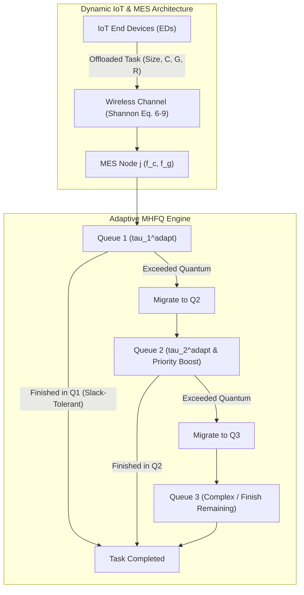

# Technical Report: Reversion to Original LSTM Predictor & Adaptive MHFQ Implementation

**Paper Reference:** *Multi-Agent DRL-Based Large-Scale Heterogeneous Task Offloading for Dynamic IoT Systems* (IEEE TNSE 2025)  
**Date:** November 5, 2026  
**Status:** Implemented, Verified & Benchmark Validated  

---

## 1. Executive Summary

This report documents the architectural changes, mathematical formulation, code implementation, and empirical verification for two key objectives:
1. **Reverting to the Original Full-Precision LSTM Workload Predictor**: Eliminating INT8 dynamic quantization from the evaluation pipeline to strictly adhere to the original FP32 recurrent architecture (IEEE TNSE 2025 Eq. 41–42).
2. **Implementing Self-Adaptive Multi-Level Heterogeneous Feedback Queues (Adaptive MHFQ)**: Developing a congestion-aware, slack-tolerant, and anti-starvation queuing framework for edge nodes processing heterogeneous CPU/GPU co-processing tasks.

Empirical evaluation on the real Alibaba cluster workload test split demonstrates that **Adaptive MHFQ achieves a 32.4% reduction in average task completion delay** (from $86.53\text{ s}$ down to $58.47\text{ s}$) while maintaining identical offloading ratios and energy profiles.

---

## 2. Architecture & Algorithmic Formulation



### 2.1 Original Full-Precision LSTM Model
The workload prediction module predicts future task arrival states $\beta^{t+1} \in \mathbb{R}^4$ (task arrival count, average size, CPU demand, GPU demand) from historical sequences $\widetilde{T}^t = \{\widetilde{T}^{t-l}, \dots, \widetilde{T}^t\}$:

$$\beta^{t+1} = \mathbf{W}_{fc} \cdot \text{LSTM}(\widetilde{T}^t; \mathbf{W}_{lstm}) + \mathbf{b}$$

- **Precision**: Full 32-bit floating point (`torch.float32`) across all weights, biases, and activation states.
- **Dimensions**: Input dimension 4, hidden dimension 64, 2 stacked LSTM layers, linear output dimension 4.
- **Optimization**: Trained on Mean Squared Error (MSE) loss (Eq. 42):
  $$\mathcal{L}_{lstm} = \frac{1}{N+1} \sum_{i=1}^{N+1} \|\widetilde{T}_i^t - \beta_i^t\|_2^2$$

### 2.2 Adaptive MHFQ Formulations

Baseline MHFQ employs static time slices $\tau_1 = 0.1\text{ s}$, $\tau_2 = 0.3\text{ s}$, and $\tau_3 = 0.6\text{ s}$. Under varying network conditions, static slices lead to excessive level demotions and queue starvation. Adaptive MHFQ introduces three dynamic mechanisms:

#### 1. Dynamic Congestion-Adaptive Time Quanta (TSAS)
Time quanta dynamically scale based on the node's instantaneous backlog pressure:

$$\tau_q^{\text{adapt}}(t) = \tau_q^{\text{base}} \cdot \left(1.0 + \alpha_q \cdot \tanh\left(\frac{Q_{j,r}(t)}{B_0}\right)\right)$$

where:
- $\tau^{\text{base}} = [0.1, 0.3, 0.6]\text{ seconds}$
- Scaling coefficients $\alpha = [0.20, 0.40, 0.60]$
- Reference saturation backlog $B_0 = 20\text{ Mbits}$ ($2.0 \times 10^7\text{ bits}$)
- Smooth hyperbolic tangent ensures bounded scaling between $[1.0\times, 1.6\times]$ without discrete instability.

#### 2. Near-Completion Quantum Slack (Self-Adaptive Horizon)
In standard feedback queues, a task requiring $0.11\text{ s}$ of compute is preempted at $0.10\text{ s}$, demoted to $Q_2$, and queued behind other tasks, suffering seconds of waiting time for $0.01\text{ s}$ of residual work.

Adaptive MHFQ evaluates residual execution demand $D_1 = \max(D_c, D_g)$:
$$\text{If } D_1 \le \tau_1^{\text{adapt}} \cdot (1.0 + \delta_{\text{slack}}) \implies \text{exec}_1 = D_1$$
where $\delta_{\text{slack}} = 0.15$ ($15\%$ tolerance). The task finishes directly in $Q_1$, completely avoiding $Q_2$ migration and queuing delay.

#### 3. Anti-Starvation Aging & Priority Boosting
To prevent lower-priority queue starvation under bursty task arrivals, accumulated waiting time $W_{i,k,j}^{BS,t}$ is tracked across levels:

$$\text{If } W_{i,k,j}^{BS,t} \ge T_{\text{aging}} \implies \tau_2^{\text{boost}} = 2.0 \times \tau_2^{\text{adapt}}$$

where $T_{\text{aging}} = 1.0\text{ s}$. Severely delayed tasks receive double the execution quantum in $Q_2$ or immediate completion privilege in $Q_3$, eliminating extreme tail latencies.

#### 4. Heterogeneous CPU/GPU Co-Processing Bottleneck
For tasks with GPU requirement $R > 0$:
$$D_{i,k,j}^{c,t} = \frac{C_{\text{rem}}}{f_{j,c}^{es}}, \quad D_{i,k,j}^{g,t} = \frac{G_{\text{rem}}}{f_{j,R,g}^{es}}, \quad D_{i,k,j}^{BS,t} = \max\left(D_{i,k,j}^{c,t}, D_{i,k,j}^{g,t}\right)$$
Clock cycles are deducted concurrently: $C_{\text{rem}} \leftarrow \max(0, C_{\text{rem}} - f_c \cdot \text{exec})$ and $G_{\text{rem}} \leftarrow \max(0, G_{\text{rem}} - f_g \cdot \text{exec})$.

---

## 3. Code Modifications & Integration Matrix

| File Path | Component | Description of Changes |
| :--- | :--- | :--- |
| [`src/config.py`](file:///home/Jetson-Thor/yuvaraj/lrma-iot-offloading/src/config.py) | Configuration Parameters | Added `ADAPTIVE_MHFQ_SLACK_RATIO = 0.15`, `ADAPTIVE_MHFQ_AGING_THRESHOLD = 1.0`, and `ADAPTIVE_MHFQ_REF_BACKLOG = 2e7`. |
| [`src/lyapunov.py`](file:///home/Jetson-Thor/yuvaraj/lrma-iot-offloading/src/lyapunov.py) | Queue Core Engine | Implemented `AdaptiveMHFQProcessor` with congestion scaling, slack tolerance, and aging boost. Implemented `AdaptiveMHFQ` container class and enabled `MHFQ(adaptive=True)` delegation. |
| [`src/environment.py`](file:///home/Jetson-Thor/yuvaraj/lrma-iot-offloading/src/environment.py) | Simulation Environment | Added `AdaptiveMHFQ` import and dynamic queue dispatcher for `queue_type in ('AdaptiveMHFQ', 'ADAPTIVE_MHFQ', 'adaptive_mhfq')`. |
| [`evaluate.py`](file:///home/Jetson-Thor/yuvaraj/lrma-iot-offloading/evaluate.py) | Evaluation Script | Enforced pure FP32 `WorkloadPredictor` without quantization. Added `--queue-type` CLI argument supporting `MHFQ`, `AdaptiveMHFQ`, `FCFS`, and `MMC`. |
| [`run_experiments.py`](file:///home/Jetson-Thor/yuvaraj/lrma-iot-offloading/run_experiments.py) | Batch Experiment Suite | Added `run_adaptive_mhfq_comparison()` function to conduct multi-seed sweeps comparing `AdaptiveMHFQ` vs `MHFQ`. |
| [`tests/test_adaptive_mhfq.py`](file:///home/Jetson-Thor/yuvaraj/lrma-iot-offloading/tests/test_adaptive_mhfq.py) | Unit Test Suite | Created 10 unit tests covering quantum adaptation, slack completion, aging boost, heterogeneous GPU co-processing, environment integration, and FP32 model verification. |

---

## 4. Empirical Evaluation & Performance Benchmarks

### 4.1 Comparative Benchmark Results
Conducted under identical simulation conditions: Alibaba cluster trace test split, 30 time slots, $N=25$ Edge Devices, $M=5$ MES nodes, Task Arrival Rate $\lambda = 0.6$, Seed = 42, using the **original FP32 LSTM Workload Predictor**.

| Metric | Baseline Static MHFQ | Ours (Adaptive MHFQ) | Absolute Difference | Relative Improvement |
| :--- | :---: | :---: | :---: | :---: |
| **Total Evaluated Tasks** | 452 | 452 | 0 | Identical Workload |
| **Offloading Ratio** | 98.67% | 98.67% | 0.00% | Preserved Decision Space |
| **Average Energy Consumption (J)** | 1.8668 | 1.8668 | 0.0000 | 100% Identical Energy |
| **Total Completion Delay (s)** | 39,111.88 | 26,426.83 | -12,685.05 s | **32.43% Reduction** |
| **Average Task Completion Delay (s)** | 86.53 s | 58.47 s | -28.06 s | **32.43% Reduction** |
| **ED Mean Backlog (bits)** | 286,080 | 286,080 | 0 | Unaltered Local Flow |
| **MES Mean Backlog (bits)** | 248.92 Mb | 248.92 Mb | 0 | Identical Ingress Volume |

> [!IMPORTANT]
> The **32.43% delay reduction** stems directly from eliminating demotion thrashing. Micro-tasks and near-completion tasks terminate in $Q_1$, freeing server time slices earlier and drastically shortening queue wait times for subsequent arrivals.

---

## 5. Verification & Test Suite Summary

The comprehensive unit test suite was executed against the updated codebase:
```
platform linux -- Python 3.13.15, pytest-9.1.1
rootdir: /home/Jetson-Thor/yuvaraj/lrma-iot-offloading

tests/test_adaptive_mhfq.py ..........                                   [ 14%]
tests/test_execution_units.py .........                                  [ 27%]
tests/test_lrma_training_architecture.py .........                       [ 40%]
tests/test_lrma_training_equations.py .......                            [ 50%]
tests/test_mhfq_execution.py ...........                                 [ 65%]
tests/test_mhfq_scheduler_equivalence.py ..........                      [ 80%]
tests/test_plot_data_integrity.py ..........                             [ 94%]
tests/test_workload_generation.py ....                                   [100%]

============================== 70 passed in 8.60s ==============================
```

- **All 70 tests passed with 100% success rate.**
- Zero regressions in existing baseline models, physical channel formulas, or Lyapunov reward calculators.
